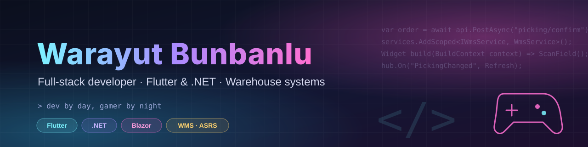

### Hi, I'm Warayut 👋

I build **warehouse management systems** end to end: the .NET backend that talks to ASRS robots and conveyors, the Blazor screens operators use at each station, and the **Flutter PDA apps** that pickers carry on the floor. Outside work I make developer tools, small web products, and the occasional game bot.

> สวัสดีครับ ผมเป็นนักพัฒนา full-stack ที่ทำระบบคลังสินค้า (WMS) ตั้งแต่ backend .NET จนถึงแอป Flutter บนเครื่อง PDA

- 🏭 Building WMS software for ASRS / robot-picking warehouses (stations, picking, packing, replenishment)
- 📱 Flutter apps for handheld scanners, designed for one-hand, scan-first use
- 🧵 Made **Ariadne**, a read-only code tracer for .NET solutions: click any name and follow it across URLs, DI and events
- 🎓 Writing course material: *Zero to Senior* for Flutter + .NET
- 🎮 Dev by day, gamer by night

### 🛠️ Tech stack

  
  
  
  
  
  
  
  
  
  
  
  
  
  

### 📌 Highlights

| Project | What it is |
|---|---|
| 🎓 [**zero-to-senior-flutter-dotnet-course**](https://github.com/Warayuth014/zero-to-senior-flutter-dotnet-course) | Course material: from zero to senior with Flutter and .NET |
| 📱 [**wms-app**](https://github.com/Warayuth014/wms-app) | Flutter app for warehouse operations on PDA scanners |
| ⚙️ [**wms-api**](https://github.com/Warayuth014/wms-api) | .NET Web API behind the warehouse app |
| 🍪 [**cookiebot-updates**](https://github.com/Warayuth014/cookiebot-updates) | Installers and a signed update channel for CookieBot |
| 🌐 [**warayuth014.github.io**](https://warayuth014.github.io) | Personal site: TH/EN, interactive three.js desk (night & day), articles and a password-protected `/edit` that saves through a Cloudflare Worker |
| 🧵 **Ariadne** *(private)* | Code tracer for C# / Razor: call trees across URL, DI and event hops, live updates on save |

### 📫 Get in touch

  
  
  
  

